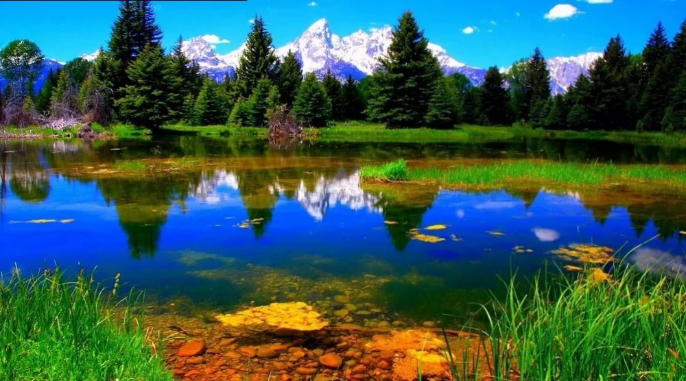
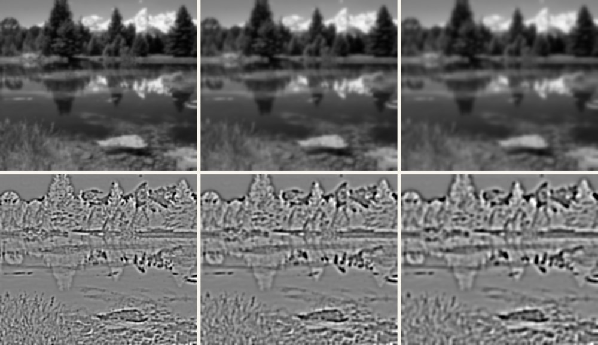
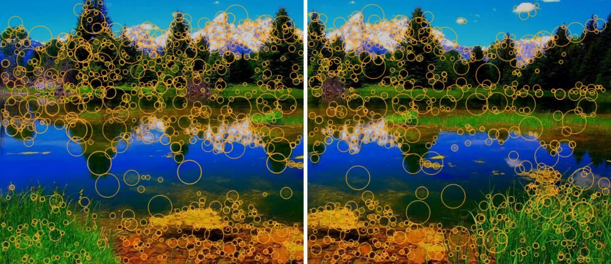
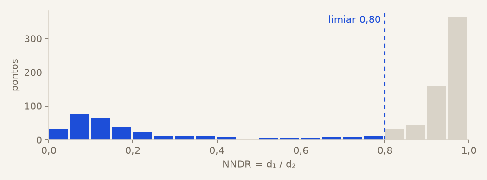
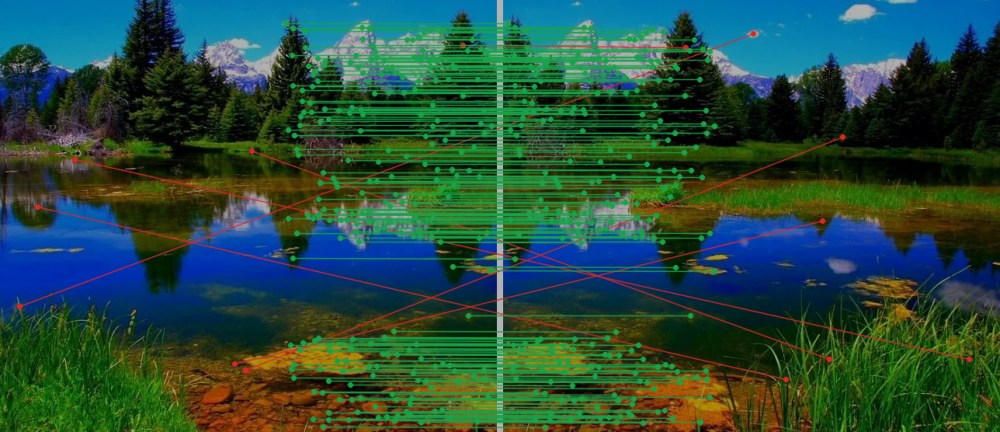
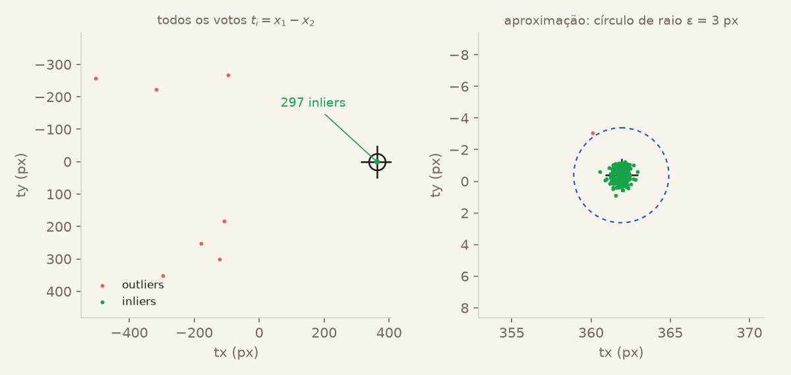
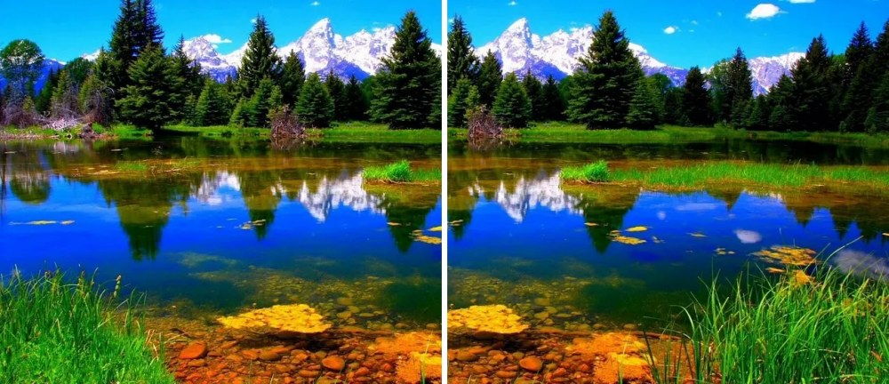

```text
 ____                                    __ _
|  _ \ __ _ _ __   ___   __ _ _ __ __ _ / _(_) __ _
| |_) / _` | '_ \ / _ \ / _` | '__/ _` | |_| |/ _` |
|  __/ (_| | | | | (_) | (_| | | | (_| |  _| | (_| |
|_|   \__,_|_| |_|\___/ \__, |_|  \__,_|_| |_|\__,_|
                        |___/
```

Costura de duas fotos sobrepostas encontrando o **deslocamento** entre elas.
Pontos marcantes são detectados com **SIFT** (ou Harris), casados pelo **teste
de razão de Lowe**, e cada par vota num deslocamento. O **RANSAC** fica com o
voto da maioria, e as fotos são mescladas por **feathering**. Tudo foi
implementado do zero em NumPy, seguindo Szeliski, *Computer Vision: Algorithms
and Applications*, 2ª ed., capítulos 7 e 8.

**[Abrir a aplicação](https://gutoportelaa.github.io/panografia_estudo/)**: roda
no navegador, sem instalar nada, e mostra cada etapa desenhada sobre as suas
próprias imagens.



```text
Detector ................ sift
Pontos detectados ....... img1 = 912, img2 = 790
Correspondências (NNDR) . 305
Inliers (RANSAC) ........ 297 (97.4%)
Iterações RANSAC ........ 2
Translação t = (tx, ty) . (361.91, -0.38) px
Erro RMS dos inliers .... 0.541 px
Mosaico (L × A) ......... 1002 × 557 px
```

## Experimente

1. #### Pelo navegador

   Abra <https://gutoportelaa.github.io/panografia_estudo/>. O site carrega o
   Python com NumPy e OpenCV dentro do navegador via
   [Pyodide](https://pyodide.org), cerca de 25 MB na primeira visita, e roda o
   mesmo código deste repositório. Nenhuma imagem sai do seu computador.

2. #### Pelo executável

   Baixe o arquivo do seu sistema em
   [Releases](https://github.com/gutoportelaa/panografia_estudo/releases)
   (Windows, Linux, macOS). Sem argumentos, ele abre a interface no navegador;
   com argumentos, funciona como linha de comando:

   ```sh
   panografia-windows.exe img1.jpg img2.jpg -o saida/
   ```

3. #### Pelo código-fonte

   ```sh
   git clone https://github.com/gutoportelaa/panografia_estudo.git
   cd panografia_estudo
   python -m venv .venv && source .venv/bin/activate
   pip install -r requirements.txt
   ```

   Linha de comando:

   ```sh
   python -m panografia data/img1.png data/img2.png -o saida/
   ```

   Interface local, processando em Python nativo:

   ```sh
   uvicorn app.server:app --reload      # http://127.0.0.1:8000
   ```

   `Atenção:` a **imagem 1** fica parada e define o quadro de referência; a
   **imagem 2** é a que se desloca. As duas precisam ter uma faixa em comum,
   de preferência mais de 20% da largura.

4. #### Veja o resultado

   A pasta de saída recebe `mosaico.jpg`, `justaposicao.jpg` (as fotos lado a
   lado, sem alinhar), `correspondencias.jpg`, `pontos1.jpg`, `pontos2.jpg`,
   `escala.jpg`, `pesos.jpg` e `resultado.json` com todos os números.

   Se o resultado não convencer, experimente:
   * `--detector harris`: outro detector, útil para comparar;
   * `--ratio 0.7`: limiar NNDR mais rigoroso, menos pares e menos ambíguos;
   * `--threshold 5`: tolerância ε maior no RANSAC, para fotos com leve rotação;
   * `--blend average`: média simples em vez de feathering, para ver a costura.

## Explicado

A ideia vem da **panografia** (Szeliski §8.1.2): colagens de fotos apenas
deslocadas, à maneira de David Hockney. O modelo de movimento é o mais simples
possível, uma **translação**:

$$\mathbf{x}_1 = \mathbf{x}_2 + \mathbf{t}, \qquad \mathbf{t} = (t_x, t_y)$$

Um ponto na posição $\mathbf{x}_2$ da imagem 2 aparece na posição
$\mathbf{x}_1$ da imagem 1. Encontrar $\mathbf{t}$ é todo o problema. As
figuras abaixo vêm de uma execução real sobre o par da atividade e foram
geradas por [`scripts/gerar_figuras.py`](scripts/gerar_figuras.py).

### 1. Ver a imagem em várias escalas

Um ponto só pode ser reconhecido nas duas fotos se for encontrado no mesmo
**tamanho**. O SIFT (Lowe 2004) monta um **espaço-escala**: a imagem $I$ é
borrada por gaussianas $G$ cada vez mais largas,

$$L(x, y, \sigma) = G(x, y, \sigma) \ast I(x, y)$$

e níveis vizinhos são subtraídos, formando a **diferença de gaussianas** (DoG):

$$D(x, y, \sigma) = L(x, y, k\sigma) - L(x, y, \sigma), \qquad k = 2^{1/s}$$

A DoG aproxima o laplaciano normalizado $\sigma^2 \nabla^2 G$ e responde
forte onde existe uma mancha ou canto **daquele tamanho**. A cada $s = 3$
níveis o sigma dobra, a imagem é reduzida à metade e começa uma nova oitava.



*Em cima, três níveis $L$ da primeira oitava. Embaixo, as DoG: cinza é zero,
claro é positivo, escuro é negativo. A textura da grama some nos níveis mais
borrados, e a silhueta das árvores continua.*

### 2. Escolher pontos e descrevê-los

Um pixel é **candidato** quando seu valor na DoG é maior (ou menor) que os 26
vizinhos: 8 na mesma escala e 9 em cada escala adjacente. Depois:

* **Refinamento subpixel.** Uma expansão de Taylor de segunda ordem de $D$ em
  torno do candidato dá a posição do extremo,
  $\hat{\mathbf{x}} = -\left(\frac{\partial^2 D}{\partial \mathbf{x}^2}\right)^{-1} \frac{\partial D}{\partial \mathbf{x}}$.
* **Pouco contraste.** Pontos com $|D(\hat{\mathbf{x}})| < 0{,}04/s$ são
  descartados, porque o ruído os move.
* **Bordas.** Numa borda reta, o ponto desliza ao longo dela. Com a hessiana
  2×2 $H$, descarta-se quando $\operatorname{tr}(H)^2 / \det(H) \ge (r+1)^2/r$,
  com $r = 10$.
* **Orientação.** Um histograma de 36 direções de gradiente em volta do ponto
  dá a orientação dominante.
* **Descritor.** Uma janela 4×4 de células, girada para a orientação, com um
  histograma de 8 direções em cada uma, dá **128 números** normalizados.

A alternativa **Harris** (Szeliski eq. 7.8–7.9) usa a matriz de
autocorrelação $A$ e a resposta
$R = \det(A) - \alpha\,\operatorname{tr}(A)^2$. A supressão não-máxima
adaptativa (ANMS) espalha os pontos pela imagem, e o descritor é um recorte
8×8 (MOPS) normalizado em brilho e contraste.



*912 pontos na imagem 1 e 790 na imagem 2. O raio de cada círculo é a escala
em que o ponto foi encontrado.*

### 3. Casar descritores parecidos

Para cada descritor $\mathbf{v}_1$ da imagem 1, mede-se a distância euclidiana
até todos os descritores da imagem 2,

$$d(\mathbf{v}_1, \mathbf{v}_2) = \sqrt{\textstyle\sum_{i=1}^{128} (v_{1i} - v_{2i})^2}$$

e guardam-se o mais próximo, $d_1$, e o segundo mais próximo, $d_2$. Se os
dois estão quase à mesma distância, o ponto é **ambíguo**, como uma folha
entre muitas folhas. O **teste de razão** (Szeliski eq. 7.18) descarta esses
casos:

$$\text{NNDR} = \frac{d_1}{d_2} < 0{,}8$$

Por fim, a **checagem mútua** exige que o vizinho de $B$ também seja $A$.



*A razão de todos os 912 pontos forma dois grupos: pares inequívocos perto de
zero e ambíguos perto de 1. O limiar fica no vale entre eles. 313 pontos
passam, e a checagem mútua deixa 305 pares.*



*Verde: pares que o RANSAC aceitou. Vermelho: os poucos pares errados que
sobreviveram ao teste de razão.*

### 4. Votar na translação com o RANSAC

Se a câmera só se deslocou, **todo par correto aponta o mesmo
deslocamento**. Então cada par $i$ vira um voto:

$$\mathbf{t}_i = \mathbf{x}_{1i} - \mathbf{x}_{2i}$$

O RANSAC (Fischler e Bolles 1981; Szeliski §8.1.4) procura a hipótese com mais
apoio:

1. Sorteia o número mínimo de pares que define o modelo. Para translação basta
   **um** ($k = 1$); uma homografia precisaria de 4.
2. Usa o voto sorteado como hipótese $\mathbf{t}$.
3. Conta os **inliers**, os votos a menos de $\varepsilon$ da hipótese:
   $\lVert \mathbf{t}_i - \mathbf{t} \rVert \le \varepsilon$, com
   $\varepsilon = 3$ px.
4. Repete $S$ vezes e fica com a hipótese de mais inliers. $S$ se ajusta
   sozinho à fração de inliers $p$ observada, para uma confiança $P = 0{,}999$:

$$S = \frac{\log(1 - P)}{\log(1 - p^k)}$$

5. Refina por **mínimos quadrados** sobre os inliers. Para translação, o
   $\mathbf{t}$ que minimiza $\sum \lVert \mathbf{x}_{2i} + \mathbf{t} - \mathbf{x}_{1i} \rVert^2$
   (Szeliski eq. 8.12) é simplesmente a **média** dos votos inliers.



*À esquerda, os 305 votos: 297 formam um aglomerado compacto sob a marca de
registro, e os 8 errados se espalham. À direita, a aproximação com o círculo de
raio ε. Com $p = 0{,}97$, o primeiro sorteio já acerta, e o RANSAC parou na 2ª
iteração.*

### 5. Mesclar sem deixar costura

Com $\mathbf{t}$ conhecido, a imagem 2 é deslocada para o quadro da imagem 1
(com interpolação bilinear, já que $\mathbf{t}$ tem parte fracionária). Na
faixa em comum, cada pixel é uma média ponderada:

$$I(\mathbf{x}) = \frac{w_1(\mathbf{x})\, I_1(\mathbf{x}) + w_2(\mathbf{x})\, I_2(\mathbf{x})}{w_1(\mathbf{x}) + w_2(\mathbf{x})}$$

* **Média simples:** $w_k = 1$. Diferenças de exposição deixam um degrau na
  borda de cada foto.
* **Feathering** (Szeliski §8.4.2): $w_k(\mathbf{x})$ é a **distância de
  $\mathbf{x}$ até a borda** da imagem $k$. Cada foto some aos poucos perto da
  própria borda, e a transição fica suave.


*Fração da imagem 2 em cada pixel, $w_2/(w_1+w_2)$. Grafite: só a imagem 1.
Cobalto: só a imagem 2. O "X" na faixa comum aparece porque o peso é a
distância até a borda **mais próxima**, que perto dos cantos é a de cima ou a
de baixo.*

### Resultado

Justaposição direta, as fotos lado a lado sem alinhamento:



Panografia, a imagem 2 deslocada por $\mathbf{t} = (361{,}91;\ -0{,}38)$ px e
mesclada:


### Comparação entre detectores

Os quatro detectores passam pelo mesmo casamento NNDR, pelo mesmo RANSAC e pela
mesma mistura; só muda o que conta como ponto e como ele é descrito. No par da
atividade (JPEG de `web/samples/`, parâmetros padrão):

| Detector | Pontos (1 / 2) | Pares NNDR | Inliers | $\mathbf{t}$ (px) | Erro RMS |
|---|---|---|---|---|---|
| SIFT (próprio) | 907 / 789 | 303 | 295 | (361,90; −0,38) | 0,54 |
| Harris + MOPS (próprio) | 1582 / 1269 | 564 | 558 | (361,91; −0,33) | 0,80 |
| SIFT (OpenCV) | 3384 / 3150 | 960 | 943 | (361,93; −0,40) | 0,59 |
| ORB (OpenCV) | 3933 / 3855 | 1022 | 995 | (361,73; −0,15) | 0,99 |

Todos chegam ao mesmo $\mathbf{t}$ com menos de 0,3 px de diferença. No
tabuleiro, três concordam em $t_x \approx -283$ px e o SIFT próprio fica em
$-226$ px: com casas iguais, ele votou num aglomerado diferente. A seção 6 do
relatório interativo refaz essa tabela para qualquer par.

### Onde a translação não basta

| Situação | O que acontece | Exemplo no site |
|---|---|---|
| A câmera gira ou muda de ponto de vista | Objetos perto e longe se deslocam de formas diferentes (paralaxe); nenhum $\mathbf{t}$ serve para todos, e o mosaico mostra contornos duplicados. O modelo adequado é uma homografia (Szeliski §8.2) | Pôster, Praça, Times Square |
| Padrão repetitivo | Casas iguais têm descritores iguais; sobram poucos pares, e o voto vencedor pode estar errado por uma casa inteira | Tabuleiro |
| Pouca sobreposição | Os votos só vêm da faixa em comum; com menos de uns 20% de sobreposição, o aglomerado fica ralo | Par sintético com tx grande |

## Imagens

| Exemplo | Origem | Licença |
|---|---|---|
| Paisagem | par fornecido na Atividade 03 da disciplina | uso acadêmico |
| Capa de livro, pôster, tabuleiro | câmera do Rover, LabVIP/UFPI | as do autor |
| Sequência aérea, escola e praça vistas do drone; prédio entre árvores, fachada, praça, rua e Times Square | [Aerial234](https://huggingface.co/datasets/RussRobin/Aerial234) e [StitchBench](https://huggingface.co/datasets/RussRobin/StitchBench), por RussRobin | CC BY 4.0 |

Os pares escolhidos já estão em `web/samples/`, reduzidos para 960 px. Para refazer a escolha
(os datasets do Hugging Face exigem login e aceite dos termos):

```sh
hf auth login
python scripts/baixar_datasets.py      # baixa só as cenas usadas
python scripts/preparar_exemplos.py    # escolhe os pares e atualiza o site
```

O site também gera **pares sintéticos**: dois recortes de qualquer imagem com
$(t_x, t_y)$ escolhido, para comparar a estimativa com o gabarito.

## Estrutura

```text
panografia/           biblioteca e linha de comando (python -m panografia)
  features/sift.py    SIFT: espaço-escala, extremos, refinamento, descritor
  features/harris.py  Harris, ANMS e descritor MOPS
  matching.py         distância entre descritores, NNDR, checagem mútua
  ransac.py           RANSAC para translação e refinamento
  compositing.py      quadro global, deslocamento subpixel, feathering
  pipeline.py         as etapas em ordem e o relatório
  service.py          entrada comum: bytes → números e figuras
web/                  interface (HTML, CSS e JS, sem build) e exemplos
app/                  servidor local (FastAPI) e ponto de entrada do executável
scripts/              site estático, figuras do README, datasets externos
tests/                29 testes (pytest), incluindo translações conhecidas
```

```sh
pip install -r requirements-dev.txt
pytest
python scripts/build_site.py && python -m http.server -d _site 8001   # site como no Pages
```

A cada push em `main`, o GitHub Actions roda os testes e publica o site; a
cada tag `v*`, gera os executáveis.

## Referências

* R. Szeliski, [*Computer Vision: Algorithms and Applications*, 2ª ed.](https://szeliski.org/Book/), 2022. Cap. 7 (detecção e correspondência) e cap. 8 (alinhamento e costura).
* D. G. Lowe, [Distinctive Image Features from Scale-Invariant Keypoints](https://www.cs.ubc.ca/~lowe/papers/ijcv04.pdf), IJCV, 2004.
* M. A. Fischler e R. C. Bolles, Random Sample Consensus, *Communications of the ACM*, 1981.
* M. Brown, R. Szeliski e S. Winder, Multi-Image Matching using Multi-Scale Oriented Patches, CVPR, 2005.
* [panorama-image-stitching](https://github.com/stanleyedward/panorama-image-stitching), de Stanley Edward: modelo para a estrutura deste README.
* A. Rosebrock, [OpenCV panorama stitching](https://pyimagesearch.com/2016/01/11/opencv-panorama-stitching/), PyImageSearch, 2016: a mesma ideia com homografia.
* Direção visual do site guiada pela skill [unslop](https://github.com/heydamir/unslop), de Damir Sokolovsky (CC BY 4.0).

## Licença

Código sob [MIT](LICENSE).
