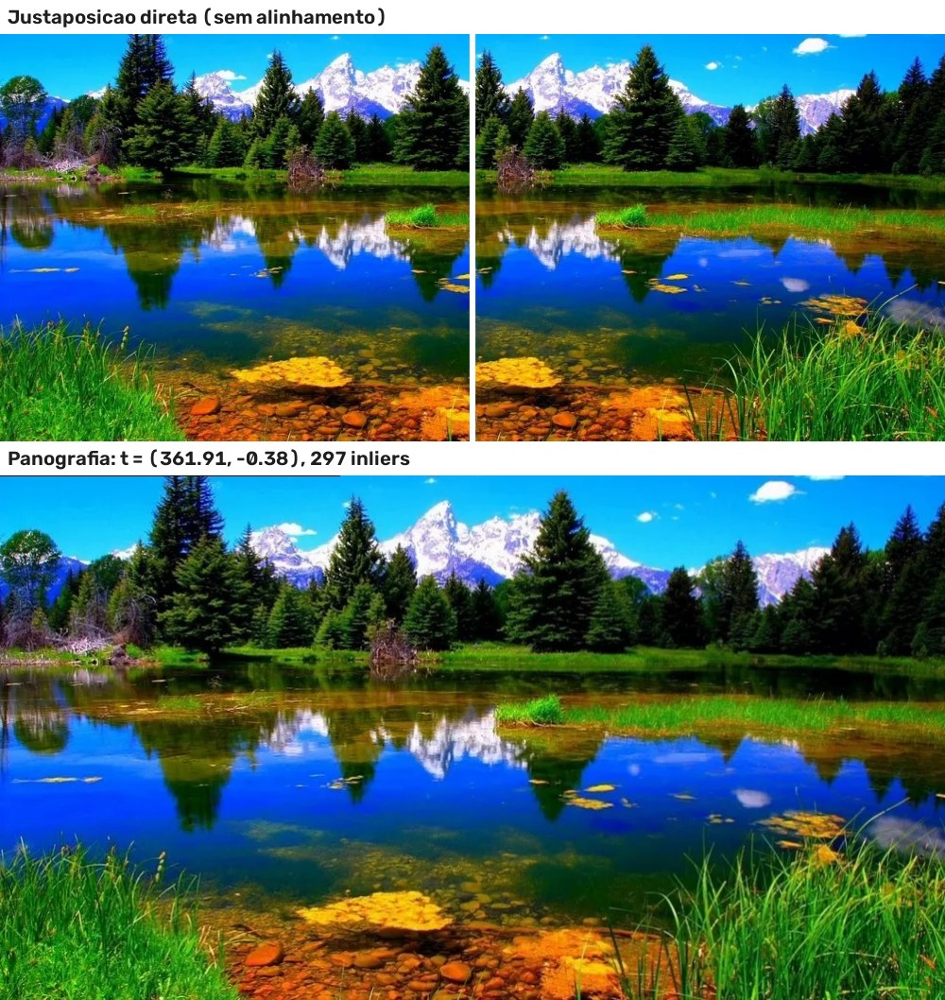

# Panografia: costura de imagens transladadas

**[Abrir a aplicação →](https://gutoportelaa.github.io/panografia_estudo/)**

Aplicação web open source que alinha duas imagens parcialmente sobrepostas por
**translação** e as mescla em um único mosaico panorâmico. Os algoritmos
principais (SIFT, Harris/MOPS, NNDR, RANSAC e feathering) foram implementados
do zero em NumPy, seguindo Szeliski, *Computer Vision: Algorithms and
Applications*, 2ª ed., capítulos 7 e 8.

No GitHub Pages, o **mesmo código Python** roda no navegador via
[Pyodide](https://pyodide.org) (WebAssembly), sem servidor e sem enviar imagens
a lugar algum. Localmente, ou pelo executável, roda em Python nativo.



## Resultado com as imagens da atividade

| Detector              | Pontos (img1/img2) | Correspondências | Inliers | t = (tx, ty)      | RMS (px) |
|-----------------------|--------------------|------------------|---------|-------------------|----------|
| **SIFT (próprio)**    | 912 / 790          | 305              | 297     | (361,91; −0,38)   | 0,54     |
| **Harris + MOPS (próprio)** | 1571 / 1279  | 562              | 554     | (361,90; −0,33)   | 0,78     |
| SIFT OpenCV (referência) | 3460 / 3193     | 983              | 967     | (361,91; −0,40)   | 0,58     |
| ORB OpenCV (referência)  | 3933 / 3866     | 1001             | 975     | (361,74; −0,14)   | 0,98     |

As implementações próprias concordam com a referência do OpenCV em menos de
0,1 px. As saídas completas estão em [`resultados/`](resultados/).

## Conjuntos de imagens

| Exemplo | Origem | O que mostra |
|---|---|---|
| **Paisagem** | par fornecido na Atividade 03 | caso principal: translação pura, 97% de inliers |
| **Capa de livro** | quadros de vídeo da câmera do Rover (LabVIP) | captura real com pequena rotação: alinha bem, RMS ≈ 1,6 px |
| **Pôster** | quadros de vídeo da câmera do Rover | **limite do modelo**: há perspectiva, e o mosaico mostra contornos duplicados |
| **Tabuleiro** | fotos da câmera do Rover | **falha**: o padrão repetitivo gera correspondências ambíguas, e SIFT e Harris discordam |
| **Par sintético** | gerado na própria página | recorta duas janelas de qualquer imagem com (tx, ty) conhecido e, opcionalmente, ruído, e mede o **erro em relação ao gabarito** |

## Como usar

### 1. Pelo navegador (sem instalar nada)

Acesse <https://gutoportelaa.github.io/panografia_estudo/>. O primeiro
carregamento baixa o Pyodide com NumPy e OpenCV (~25 MB, depois fica em cache).

### 2. Executável (Windows, Linux, macOS)

Baixe o arquivo da sua plataforma na página de
[Releases](https://github.com/gutoportelaa/panografia_estudo/releases).

* **Duplo clique** (ou execução sem argumentos): abre a interface no navegador,
  processando em Python nativo.
* **Com argumentos**: funciona como linha de comando:
  `panografia img1.jpg img2.jpg -o saida/`.

### 3. A partir do código-fonte

Requer Python ≥ 3.10.

```bash
python -m venv .venv && source .venv/bin/activate
pip install -r requirements.txt

uvicorn app.server:app --reload                              # interface em http://127.0.0.1:8000
python -m panografia data/img1.png data/img2.png -o saida/   # linha de comando
```

Saída da linha de comando:

```
Detector ................ sift
Pontos detectados ....... img1 = 912, img2 = 790
Correspondências (NNDR) . 305
Inliers (RANSAC) ........ 297 (97.4%)
Iterações RANSAC ........ 2
Translação t = (tx, ty) . (361.91, -0.38) px
Erro RMS dos inliers .... 0.541 px
Mosaico (L × A) ......... 1002 × 557 px
```

Gera `mosaico.jpg`, `justaposicao.jpg`, `correspondencias.jpg`,
`contornos.jpg`, `pontos1.jpg`, `pontos2.jpg` e `resultado.json`. Opções:
`--detector {sift,harris,opencv-sift,opencv-orb}`,
`--blend {feather,average,overlay}`, `--ratio`, `--threshold`, `--no-mutual`.

## Pipeline

| Etapa | Módulo | Referência (Szeliski 2ª ed.) |
|---|---|---|
| **SIFT**: pirâmide DoG, extremos 3×3×3, refinamento subpixel, rejeição de baixo contraste e de bordas, orientação dominante, descritor 4×4×8 | [`features/sift.py`](panografia/features/sift.py) | §7.1.1–7.1.2, Fig. 7.11, 7.16 |
| **Harris**: R = det(A) − α·tr(A)², ANMS e descritor MOPS 8×8 normalizado | [`features/harris.py`](panografia/features/harris.py) | §7.1.1, eq. 7.8–7.9; §7.1.2 |
| **Correspondência**: vizinho mais próximo, razão NNDR = d₁/d₂ e checagem mútua | [`matching.py`](panografia/matching.py) | §7.1.3, eq. 7.18 |
| **RANSAC** com amostra mínima k = 1 (t = x₁ − x₂), iterações adaptativas S = log(1−P)/log(1−pᵏ) e refinamento por mínimos quadrados (média dos inliers) | [`ransac.py`](panografia/ransac.py) | §8.1.2, eq. 8.12; §8.1.4, eq. 8.30 |
| **Composição**: translação subpixel, média simples, feathering (blending linear por mapa de distância) ou sobreposição | [`compositing.py`](panografia/compositing.py) | §8.4.2 |

Convenção: **x₁ = x₂ + t**, ou seja, *t* leva coordenadas da imagem 2 para o
quadro da imagem 1. O OpenCV é usado apenas para operações elementares
(leitura de imagens, filtros gaussianos, `warpAffine`, transformada de
distância) e para os detectores de referência `opencv-sift` e `opencv-orb`.

## Arquitetura

```
panografia/          biblioteca (algoritmos) + CLI (python -m panografia)
  features/          SIFT, Harris/MOPS e detectores de referência do OpenCV
  matching.py        NNDR + checagem mútua
  ransac.py          RANSAC para translação
  compositing.py     quadro global, warp e blending
  pipeline.py        orquestração e relatório
  service.py         entrada comum: bytes → (métricas, JPEGs)
web/                 interface estática (HTML/CSS/JS, sem build) + exemplos
  pyodide-worker.js  executa panografia/service.py no navegador
app/server.py        servidor FastAPI local (mesma interface + API)
app/launcher.py      ponto de entrada do executável
scripts/build_site.py  monta _site/ para o GitHub Pages
tests/               testes automatizados (pytest)
```

A interface escolhe o motor sozinha. Se houver servidor (`api/config`), usa o
Python nativo; caso contrário (GitHub Pages), carrega o Pyodide num Web Worker.
Para forçar o Pyodide localmente, use `?engine=pyodide`.

| Método | Rota | Descrição |
|---|---|---|
| `GET` | `/api/config` | detectores, modos de blending e valores padrão |
| `POST` | `/api/stitch` | `multipart/form-data` com `img1`, `img2` e parâmetros opcionais (`detector`, `blend`, `ratio`, `mutual`, `ransac_threshold`, `max_points`, `max_side`) |

Imagens com lado maior que `max_side` (1600 px por padrão) são reduzidas pelo
mesmo fator. A resposta traz `t` na escala processada e `t_original` na escala
original.

## Desenvolvimento

```bash
pip install -r requirements-dev.txt
pytest                                    # 24 testes
python scripts/build_site.py && python -m http.server -d _site 8001
pip install pyinstaller && pyinstaller panografia.spec   # executável em dist/
```

* **A cada push em `main`**: o GitHub Actions roda os testes e publica o site.
* **A cada tag `v*`**: gera os executáveis e os anexa a uma Release.

## Licença

Código sob [MIT](LICENSE). As imagens do Rover foram capturadas no LabVIP/UFPI
pelo autor.
